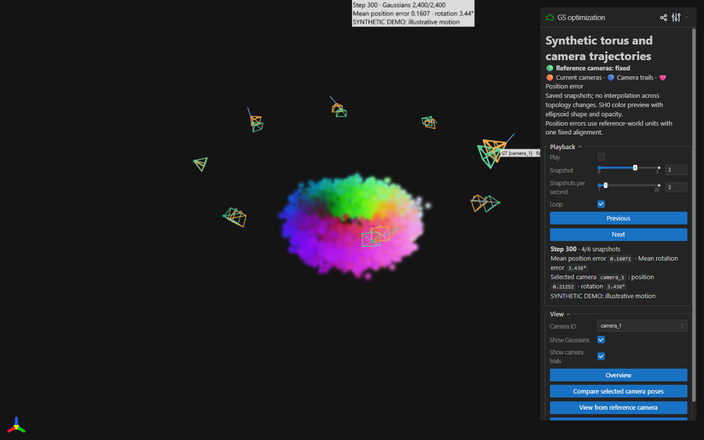

# gsoptviz

Visualize **3D Gaussian splats and camera poses together across optimization snapshots**.
Play back changing geometry, Gaussian counts, and camera trajectories in a browser,
or export a standalone HTML animation or MP4.

[中文说明](README.zh-CN.md)



## Features

- Update Gaussian positions, ellipsoid shapes, opacity, color, and count at each saved step.
- Compare current cameras (orange) with fixed reference cameras (green), camera trails
  (blue), and position-error lines (pink).
- Play, pause, step, scrub, select a camera, and inspect position and rotation errors.
- Switch between overview, pose comparison, and selected camera views.
- Read standard 3DGS PLY or explicit NumPy snapshots. Record from any training loop.
- Use the viewer without PyTorch, CUDA, or a training framework. Rendering runs in browser WebGL.

**Rendering scope:** this is an ellipsoid/opacity viewer with SH0/DC color preview.
View-dependent higher-order spherical harmonics are not rendered. Use your training
renderer for image-quality evaluation.

## Install and try

Requires Python 3.10 or newer and a browser with WebGL support. From a checkout:

```bash
python -m venv .venv
# Linux/macOS:
source .venv/bin/activate
# Windows PowerShell: .venv\Scripts\Activate.ps1
python -m pip install -e .
python examples/make_demo.py
gsoptviz serve demo_sequence/manifest.json --port 8080
```

Open <http://127.0.0.1:8080>. The demo generates six small, synthetic torus snapshots
with changing Gaussian counts and moving cameras. It contains no dataset or trained
checkpoint; the motion illustrates the viewer and is not an optimization result.
Use a new output directory when generating another sequence.

Viser is pinned to `1.1.1` because standalone playback relies on its serialization behavior.

For a remote machine, run the viewer there and forward its loopback port:

```bash
ssh -N -L 8080:127.0.0.1:8080 user@host
```

## Commands

```bash
gsoptviz inspect demo_sequence/manifest.json
gsoptviz export demo_sequence/manifest.json --output artifacts/demo.html --fps 3
gsoptviz export demo_sequence/manifest.json --output artifacts/preview.html --max-gaussians 1000
```

The exported HTML contains its assets and can be opened without a Python server.
It starts paused; use the bottom timeline to play and seek. All Gaussians are shown
unless `--max-gaussians` explicitly enables deterministic subsampling.

Optional MP4 export requires Playwright Chromium and an FFmpeg binary supplied by
`imageio-ffmpeg`:

```bash
python -m pip install -e ".[video]"
python -m playwright install chromium
gsoptviz video demo_sequence/manifest.json --output artifacts/demo.mp4 --fps 3
gsoptviz video demo_sequence/manifest.json --output artifacts/camera.mp4 --view camera --camera-id camera_0
```

On Linux, Playwright may also need system libraries; see its
[browser installation guide](https://playwright.dev/python/docs/browsers#install-system-dependencies).
`--browser /path/to/chromium` selects an existing Chromium executable. Video export
uses software WebGL and a fixed observation view. HTML and live viewing do not
require Playwright or FFmpeg. Export destinations must not already exist.

## Record your own optimization

```python
from gsoptviz import Recorder

recorder = Recorder(
    "my_sequence", gt_c2w=reference_poses, K=intrinsics,
    width=640, height=480, camera_ids=camera_ids,
)
for step in saved_steps:
    # Supply complete Gaussian and camera states from the same saved step.
    recorder.record(step, {
        "means": means,                  # (N, 3)
        "log_scales": log_scales,        # (N, 3), natural log of axis stddev
        "quats_wxyz": quaternions,       # (N, 4)
        "opacity_logits": opacity,       # (N,), before sigmoid
        "sh_dc": sh_dc,                  # (N, 3), SH coefficients, not RGB
    }, current_c2w)
```

Inputs are NumPy arrays; convert Torch tensors with `detach().cpu().numpy()`.
`Recorder` takes OpenCV camera-to-world poses and writes compressed NPZ snapshots
with an atomically updated manifest. The output directory must be new. Reference
poses remain fixed and are used to compute errors; the viewer does not update them.
The tool does not implement an optimizer.

## Input format

```json
{
  "schema_version": 1,
  "title": "My optimization",
  "camera_convention": "opencv",
  "pose_type": "c2w",
  "camera_ids": ["camera_0", "camera_1"],
  "gt_c2w": "gt_c2w.npy",
  "K": [[500, 0, 320], [0, 500, 240], [0, 0, 1]],
  "width": 640,
  "height": 480,
  "frames": [
    {"step": 0, "gaussians": "000000.npz", "cameras": "000000_c2w.npy"},
    {"step": 100, "gaussians": "000100.npz", "cameras": "000100_c2w.npy"}
  ]
}
```

File paths are relative to the manifest directory; absolute paths are accepted.
Camera arrays are `(C, 4, 4)` with a fixed count and order matching `camera_ids`.
Intrinsics `K` may be `(3, 3)` or `(C, 3, 3)`. Steps must be strictly increasing,
nonnegative integers. Gaussian counts can change between snapshots.

| Gaussian input | Parameters |
| --- | --- |
| NumPy `.npz` | `means`, `log_scales`, `quats_wxyz`, `opacity_logits`, `sh_dc`, as above |
| Standard 3DGS `.ply` | `x/y/z`, `scale_0..2` (log), `rot_0..3` (wxyz), `opacity` (logit), `f_dc_0..2` |

An optional `sh_rest` array can be archived by the recorder but is not rendered.
NumPy files are loaded with `allow_pickle=False`.

The optional [Torch converter](convert_torch_sequence.py) accepts exported model
dictionaries with a `splats` key (or the parameter dictionary itself): `means`,
`scales` (log), `quats` (wxyz), `opacities` (logit), `sh0`, and optional `shN`.
Run it in an environment with Torch and gsoptviz installed:

```bash
python convert_torch_sequence.py torch_manifest.json --output portable_sequence
```

Use the same manifest schema with `.pt` Gaussian paths and explicit `.npy` camera
arrays. The converter uses `torch.load(weights_only=True)` on CPU. It does not infer
camera poses from optimizer state. Metadata is preserved; review your own metadata,
titles, and paths before sharing exported sequences.

## Coordinates and errors

Supported input conventions are `opencv` (+X right, +Y down, +Z forward) and
`opengl` (+X right, +Y up, -Z forward), with `c2w` or `w2c` poses. These fields
apply to both reference and current poses, even though the reference key is named
`gt_c2w`. Poses must contain proper rotations without embedded scale.

By default all Gaussians and cameras share one world frame. To map the model world
to the reference world, supply one fixed similarity in the manifest:

```json
"model_to_gt": {
  "scale": 1.0,
  "rotation": [[1, 0, 0], [0, 1, 0], [0, 0, 1]],
  "translation": [0, 0, 0]
}
```

This applies `x_ref = scale * rotation @ x_model + translation` to every snapshot,
including Gaussian covariances and current cameras. Reference cameras stay fixed.
No per-frame alignment is fitted. Position errors use reference-world units;
rotation errors are geodesic angles in degrees.

## Practical limits

- Playback speed means saved snapshots per second, not elapsed training time.
- Snapshots are discrete. Missing optimization steps and Gaussian correspondences
  across densification or pruning are not interpolated.
- Full snapshots can use substantial disk space. Choose a suitable recording interval.
- Live viewing caches two Gaussian snapshots and preloads the camera sequence.
- Standalone HTML preloads all Gaussian snapshots to support changing counts during
  replay, so memory grows with their total size. Prefer live viewing or MP4 for long
  sequences, or use an explicit Gaussian limit for a lighter preview.
- Very low opacity may make a snapshot nearly invisible even when its geometry is present.

## Development

```bash
python -m pip install -e ".[test]" build
python -m pytest -q
python -m build
```

Tests cover input formats, changing topology, coordinate conventions, fixed
alignment, camera errors, and viewer scene updates. CI also generates and exports
the synthetic demo. To run the optional browser regression test, install the
`video` extras and set `GSOPTVIZ_BROWSER` to a Chromium executable before running
pytest. This checks visible first-frame content and seeking with network access
blocked. MP4 rendering requires a separate end-to-end check.

Built on [Viser](https://github.com/nerfstudio-project/viser), which provides the
WebGL Gaussian renderer, scene UI, and standalone scene serialization. Runtime
dependencies retain their respective licenses.
